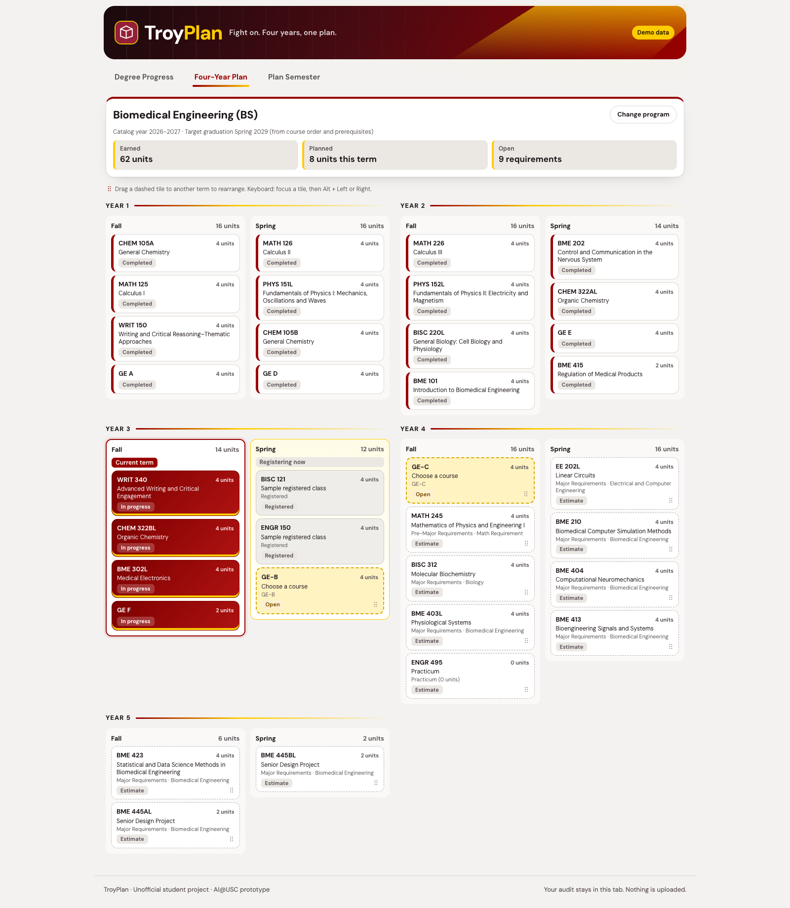

<div align="center">


# TroyPlan

### See what’s left. Plan what’s next.

Turn a USC degree audit into a semester schedule,
with a clear view of the path to graduation.

[](#development)
[](#how-planning-works)
[](#privacy)
[](#webreg-companion)

[Open TroyPlan](https://troyplan.vercel.app) · [Get started](#use-troyplan) · [Explore TroyPlan](#inside-troyplan) · [Privacy](#privacy)

</div>


TroyPlan is a web-based degree planning platform that connects **what your degree requires** with **what fits your week**. Import a text-based STARS audit, review remaining requirements, compare courses, and build a proposed Spring 2027 schedule. A bundled USC Catalogue snapshot supports major and minor selection and a term-by-term planning board.

Visit **[troyplan.vercel.app](https://troyplan.vercel.app)** to start planning in your browser. The included fictional student lets you explore immediately, without installing anything or signing in. TroyPlan is an independent platform, unaffiliated with USC; confirm degree and registration decisions with your academic advisor.

## Use TroyPlan

1. Open **[TroyPlan](https://troyplan.vercel.app)**.
2. Explore the sample student or import a text-based STARS audit.
3. Review **Degree Progress**, organize courses in **Four-Year Plan**, and compare sections in **Plan Semester**.

The website is hosted on Vercel. Accounts, API keys, and a local server are not required to use it.

## Inside TroyPlan

| View | What you can do |
| --- | --- |
| **Degree Progress** | Import a STARS PDF or pasted text; review earned, in-progress, and remaining units; select a major and optional minor; find courses for unmet requirements. |
| **Four-Year Plan** | Inspect courses by term, fill GE slots, drag future courses between terms, inspect prerequisite warnings, and explore a course-order graduation projection. |
| **Plan Semester** | Describe your preferences, compare GE options, review section bundles and instructor information, and see meetings on a weekly calendar. |

### A degree plan you can inspect



Completed, in-progress, registered, planned, and estimated coursework have readable labels. Open a course to inspect its prerequisites, drag it to another term, or move it with Alt+Left/Right. Future terms are planning estimates; published section times are available only for the supported semester snapshot.

### Find a course that fits


A request like “Find me a GE-B with a highly rated professor, no classes before 10, and keep me at 16 units or less” becomes editable settings. Each result explains what it counts for, when it meets, who teaches it, and what needs checking. **Demo instructor ratings and review counts are fictional.**

### Check the week before registration


Compare a plan with saved myCourseBin section numbers, surface conflicts, and swap to an alternate section bundle. Copy section numbers when ready; registration stays under your control.

*Screenshots are real Playwright captures of the deployed website using its fictional sample student. They contain no personal audit or authenticated portal data.*

## How planning works

1. **Read the audit.** PDF.js extracts text in your browser; the parser identifies requirements and unit totals. Imported course-credit hints need confirmation before the planner uses them.
2. **Interpret the goal.** Chrome’s on-device Prompt API can read the typed goal when available. Bundled rules provide a fallback. The model never receives the audit or chooses courses.
3. **Validate the plan.** Deterministic code checks supported prerequisites, corequisites, section bundles, unit totals, and overlapping meetings. GE ranking adjusts sample ratings for review count.
4. **Explain the result.** Recommendations show their purpose and constraints; uncertain eligibility and unmet preferences remain visible.

The bundled catalogue contains program requirements, not a complete semester section inventory. Scheduling coverage is deliberately narrower than the list of available majors and minors.

## WebReg companion

The optional Chrome extension presents a two-tab drawer alongside WebReg:

1. Open `chrome://extensions` and enable **Developer mode**.
2. Choose **Load unpacked** and select this repository’s `extension/` folder.
3. Click the extension icon and choose **Try demo** to rehearse without signing in.

On `https://webreg.usc.edu/*`, **Live** mode can read sections already displayed in myCourseBin or a course list. It does not click Schedule, Register, Drop, or payment controls. Live ratings are not loaded; instructor links open Rate My Professors searches. The drawer’s **Open website** link opens [troyplan.vercel.app](https://troyplan.vercel.app).

All state clears on page navigation or refresh. A course-list fit check cannot include registered classes read on a previous page; the UI warns about that limitation. Authenticated USC portal behavior has not been verified.

## Privacy

Reports, parsed audits, preferences, and schedules stay in page memory. There is no backend, authentication, analytics, hosted model API, or persistent browser storage. The app requests bundled static assets only; imports are not uploaded or logged. Copying section numbers writes them to the clipboard only after a click.

PDF.js is pinned and served with the website. Imports have size, page, text-length, and extraction-time limits; imported strings render as text. The hosted website applies a Content Security Policy and security headers while processing audit imports in your browser.

The extension shares WebReg’s document. Its shadow root isolates styles, not sensitive content from host-page scripts. Use fictional data for demonstrations; prefer the website for audit review.

Read [SECURITY.md](SECURITY.md) for checks and limitations and [THIRD_PARTY.md](THIRD_PARTY.md) for bundled dependency provenance. Security checks reduce risk; they do not guarantee vulnerability-free code.

## Development

The live platform is available at **[troyplan.vercel.app](https://troyplan.vercel.app)**. The following setup is for contributors who want to run or modify the source.

### Run a development server

Requires **Node.js 20+**. Verified with Node.js 24. No install step or runtime npm dependencies.

```sh
git clone https://github.com/realjeffreyau/usc-ai-hackathon-project-2026.git
cd usc-ai-hackathon-project-2026
npm start
```

For development, open **http://127.0.0.1:8080**. The fictional audit loads automatically. Use `PORT=9000 npm start` if port 8080 is occupied.

### Checks and tooling

```sh
npm test                 # parser, planning, catalogue, board, privacy, and server checks
npm run build:extension  # synchronize shared source and bundled assets
npm run dev              # local preview with shared-module synchronization
npm run e2e              # website, drag-and-drop, major/minor, GE slots, mobile, and keyboard checks
node scripts/e2e-privacy.mjs  # PDF/text imports, section conflicts, network/storage, and viewport checks
npm run e2e:extension    # actual unpacked extension against fictional WebReg pages
```

**Verification:** 76 unit/static checks, 11 website workflow checks, 12 import/privacy workflow checks, and 18 extension browser checks. Gitleaks found no secrets; the pinned PDF.js dependency audit reported zero known vulnerabilities.

Browser checks need a separate Playwright installation. Set `PLAYWRIGHT_CORE` to its package directory and, when needed, `CHROME_PATH` to a compatible full Chrome/Chromium executable. `SHOTS_DIR=docs/images npm run e2e` saves browser-test captures using fictional data.

| Path | Purpose |
| --- | --- |
| `dist/panel.js` · `dist/panel.css` | Shared website and extension interface |
| `dist/audit.js` · `dist/vendor/` | Local STARS parsing and PDF text extraction |
| `dist/planner.js` · `dist/logic.js` · `dist/ge.js` | Preferences, eligibility, section bundles, and conflicts |
| `dist/board.js` · `dist/programs.js` · `dist/programs/` | Term planning and bundled public catalogue requirements |
| `extension/` | Unpacked Chrome companion |
| `tests/` · `scripts/e2e*.mjs` | Fictional fixtures and automated checks |

`dist/` contains maintained source. Run `npm run build:extension` after shared changes, then reload the extension and its WebReg tab. Catalogue refresh scripts are developer tools; they retrieve public USC data, not student records.

## Current limits

- Scheduling currently supports a curated set of Spring 2027 sections; seat counts and instructor assignments can become stale.
- Real STARS layouts may differ. Scanned/image PDFs and encrypted reports are unsupported. Missing or ambiguous credits require review.
- Catalogue requirement extraction is heuristic. Selecting a major does not establish complete degree-rule validation or complete scheduling coverage.
- Live WebReg prerequisites, clearance, GE categories, and section pairing rules still need confirmation in USC’s systems.
- Degree Progress estimates graduation from remaining units; the Four-Year Plan uses bundled course order and prerequisite rules. These estimates can differ. Future offerings and unresolved AP or transfer credit can change either result.
- Chrome’s on-device model is optional. The browser checks exercise the rules fallback; they do not establish model-backed success. Chromium was checked; Safari and Firefox were not.
