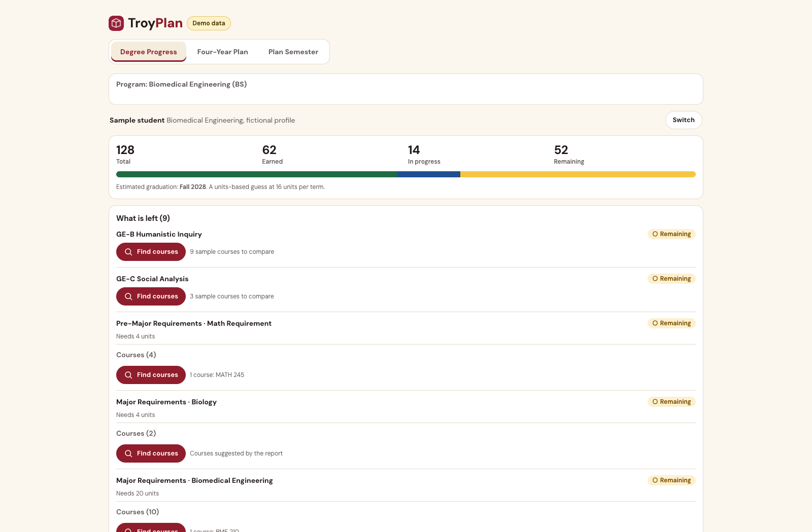
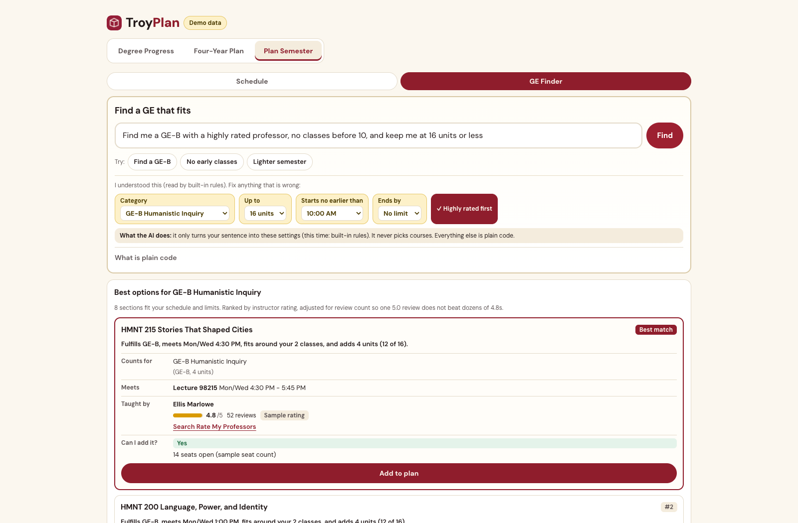
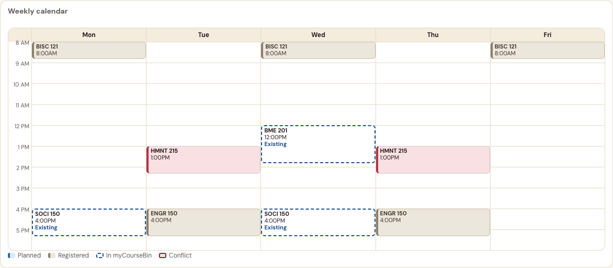

<div align="center">


# TroyPlan

### See what’s left. Plan what’s next.

Turn a USC degree audit into a semester schedule,
with a clear view of the path to graduation.

[](#development)
[](#how-planning-works)
[](#privacy)
[](#webreg-companion)

[Get started](#run-locally) · [Explore TroyPlan](#inside-troyplan) · [Privacy](#privacy)

</div>



TroyPlan connects **what your degree requires** with **what fits your week**. Import a text-based STARS audit, review remaining requirements, compare courses, and build a proposed Spring 2027 schedule. A bundled USC Catalogue snapshot supports major and minor selection and a term-by-term planning board.

The included fictional student lets you explore immediately, without a USC login, API key, or database. This is an unofficial prototype, not a USC service or academic advising tool.

## Inside TroyPlan

| View | What you can do |
| --- | --- |
| **Degree Progress** | Import a STARS PDF or pasted text; review earned, in-progress, and remaining units; select a major and optional minor; find courses for unmet requirements. |
| **Four-Year Plan** | Inspect courses by term, fill GE slots, move future courses, and see prerequisite warnings and a units-based graduation projection. |
| **Plan Semester** | Describe your preferences, compare GE options, review section bundles and instructor information, and see meetings on a weekly calendar. |

### A degree plan you can inspect


Completed, in-progress, registered, planned, and estimated coursework have readable labels. Open a course to inspect its prerequisites or move it to another term. Future terms are planning estimates; published section times are available only for the supported semester snapshot.

### Find a course that fits



A request like “Find me a GE-B with a highly rated professor, no classes before 10, and keep me at 16 units or less” becomes editable settings. Each result explains what it counts for, when it meets, who teaches it, and what needs checking. **Demo instructor ratings and review counts are fictional.**

### Check the week before registration



Compare a plan with saved myCourseBin section numbers, surface conflicts, and swap to an alternate section bundle. Copy section numbers when ready; registration stays under your control.

*Screenshots are real Playwright captures of this repository’s local app using its fictional sample student. They contain no personal audit or authenticated portal data.*

## Run locally

Requires **Node.js 20+**. Verified with Node.js 24. No install step or runtime npm dependencies.

```sh
git clone https://github.com/realjeffreyau/usc-ai-hackathon-project-2026.git
cd usc-ai-hackathon-project-2026
npm start
```

Open **http://127.0.0.1:8080**. The fictional audit loads automatically. Use `PORT=9000 npm start` if port 8080 is occupied.

## How planning works

1. **Read the audit.** Local PDF.js extracts text; the parser identifies requirements and unit totals. Imported course-credit hints need confirmation before the planner uses them.
2. **Interpret the goal.** Chrome’s on-device Prompt API can read the typed goal when available. Bundled rules provide a fallback. The model never receives the audit or chooses courses.
3. **Validate the plan.** Deterministic code checks supported prerequisites, corequisites, section bundles, unit totals, and overlapping meetings. GE ranking adjusts sample ratings for review count.
4. **Explain the result.** Recommendations show their purpose and constraints; uncertain eligibility and unmet preferences remain visible.

The bundled catalogue contains program requirements, not a complete semester section inventory. Scheduling coverage is deliberately narrower than the list of available majors and minors.

## WebReg companion

The optional Chrome extension presents a two-tab drawer alongside WebReg:

1. Open `chrome://extensions` and enable **Developer mode**.
2. Choose **Load unpacked** and select this repository’s `extension/` folder.
3. Click the extension icon and choose **Try demo** to rehearse without signing in.

On `https://webreg.usc.edu/*`, **Live** mode can read sections already displayed in myCourseBin or a course list. It does not click Schedule, Register, Drop, or payment controls. Live ratings are not loaded; instructor links open Rate My Professors searches. The drawer’s **Open website** link points to the local app at port 8080.

All state clears on page navigation or refresh. A course-list fit check cannot include registered classes read on a previous page; the UI warns about that limitation. Authenticated USC portal behavior has not been verified.

## Privacy

Reports, parsed audits, preferences, and schedules stay in page memory. There is no backend, authentication, analytics, hosted model API, or persistent browser storage. The app requests bundled static assets only; imports are not uploaded or logged. Copying section numbers writes them to the clipboard only after a click.

PDF.js is pinned and bundled locally. Imports have size, page, text-length, and extraction-time limits; imported strings render as text. The local server binds to loopback, rejects writes and untrusted Host values, and applies security headers.

The extension shares WebReg’s document. Its shadow root isolates styles, not sensitive content from host-page scripts. Use fictional data for demonstrations; prefer the standalone app for audit review.

Read [SECURITY.md](SECURITY.md) for checks and limitations and [THIRD_PARTY.md](THIRD_PARTY.md) for bundled dependency provenance. Security checks reduce risk; they do not guarantee vulnerability-free code.

## Development

```sh
npm test                 # parser, planning, catalogue, board, privacy, and server checks
npm run build:extension  # synchronize shared source and bundled assets
npm run dev              # local preview with shared-module synchronization
npm run e2e              # standalone workflow, import, network/storage, and viewport checks
npm run e2e:extension    # actual unpacked extension against fictional WebReg pages
```

**Verification:** 73 unit/static checks, 12 standalone browser checks, and 8 extension browser checks. Gitleaks found no secrets; the pinned PDF.js dependency audit reported zero known vulnerabilities.

Browser checks need a separate Playwright installation. Set `PLAYWRIGHT_CORE` to its package directory and, when needed, `CHROME_PATH` to a compatible full Chrome/Chromium executable. `SHOTS_DIR=docs/images npm run e2e` reproduces the README screenshots from fictional data.

| Path | Purpose |
| --- | --- |
| `dist/panel.js` · `dist/panel.css` | Shared website and extension interface |
| `dist/audit.js` · `dist/vendor/` | Local STARS parsing and PDF text extraction |
| `dist/planner.js` · `dist/logic.js` · `dist/ge.js` | Preferences, eligibility, section bundles, and conflicts |
| `dist/board.js` · `dist/programs.js` · `dist/programs/` | Term planning and bundled public catalogue requirements |
| `extension/` | Unpacked Chrome companion |
| `tests/` · `scripts/e2e*.mjs` | Fictional fixtures and automated checks |

`dist/` contains maintained source. Run `npm run build:extension` after shared changes, then reload the extension and its WebReg tab. Catalogue refresh scripts are developer tools; they retrieve public USC data, not student records.

## Current limits

- Prototype snapshot of work in progress. Only a curated set of Spring 2027 sections is supported; seat counts and instructor assignments can become stale.
- Real STARS layouts may differ. Scanned/image PDFs and encrypted reports are unsupported. Missing or ambiguous credits require review.
- Catalogue requirement extraction is heuristic. Selecting a major does not establish complete degree-rule validation or complete scheduling coverage.
- Live WebReg prerequisites, clearance, GE categories, and section pairing rules still need confirmation in USC’s systems.
- Graduation dates are units-based projections. Future offerings, prerequisite chains, and unresolved AP or transfer credit can change them.
- Chrome’s on-device model is optional. The browser checks exercise the rules fallback; they do not establish model-backed success. Chromium was checked; Safari and Firefox were not.
